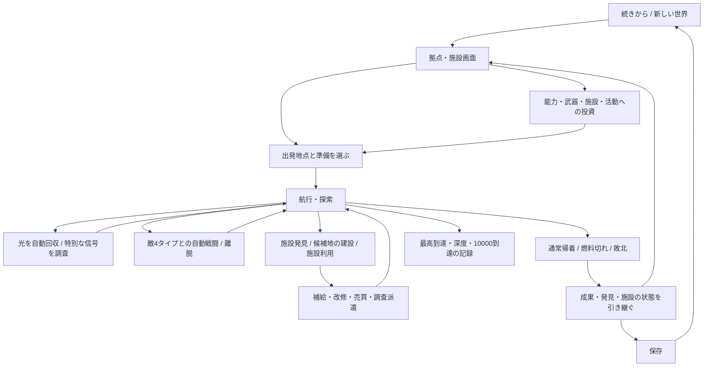
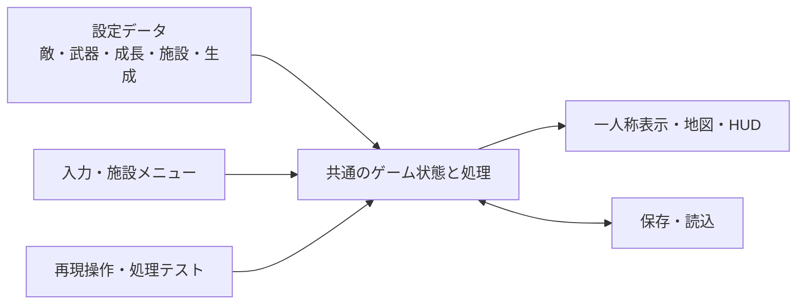

# CLOUD / PROBE — 全体模型の設計図 v0.3

> 共有版：PC固有のユーザーパスを一般化しています。旧模型のパスは当時の履歴です。現在の本体はリポジトリの `godot-foundation/`。
作成・更新：2026-11-07。状態：**全体の方向を確認後、v0.2の土台を実装。数値と具体的なルールは引き続き仮案。**

v0.3：ユーザーの試遊を受けて床と視点を変更し、起点近くの敵1体と個体ごとの待機・巡回を追加。通常生成の配分と位置の決め方は維持した。

目的は、分かっている範囲のゲーム全体をつなぎ、一つの模型を継続して育てられるようにすること。今回の設計図は、リポジトリの正式仕様や共通ルールとして設置したものではない。

読む順番：まず「1〜4」で遊びと範囲を確認し、「5〜9」で各機能のつながりを見る。Godotでの構成と実装手順は「10以降」と[制作手順書](cloud-probe-build-plan.md)に記載。

## 1. この模型で見たいゲーム全体

**弱い探索者として広大な未知空間へ出発し、発見・戦闘・交易などの成果を使って発展し、以前は届かなかった場所へ届くようになるゲーム。**

- まずは半径約10000、縮尺切り替えなし。
- 初期状態から世界の果てへ到達できる性能にはしない。
- 対象数、移動速度、報酬、初期能力は控えめにする。
- 操作は簡単にする。敵の危険や未知の厳しさを一律に弱める意図はない。
- 敵に初めて遭遇してわけも分からずやられることも、成長して再挑戦する過程の一部になり得る。
- 一回の出撃の快適さだけでなく、繰り返した結果の変化を確認する。
- 世界観・見た目・全要素の採否は、模型を使いながら検討する。

### 局所模型との違い

全体模型では、次の流れが同じゲーム状態の上で成立する必要がある。

1. 出発施設と準備を選ぶ。
2. 航行し、光・イベント・敵・施設に出会う。
3. 回収・戦闘・回避・交易・施設利用などから成果や情報を得る。
4. 通常帰着、燃料切れ、敗北などで探索を区切る。
5. 残った成果を、能力・武器・施設・活動へ配分する。
6. 次の探索で到達範囲や対処できる相手が変わる。
7. 終了・再起動後にも、世界と進行の必要な情報が残る。

見た目だけの場面、敵だけの場面、資金が増えるだけの場面を、それぞれ独立した完成物として扱わない。開発途中の部品確認は行うが、全体模型の完成判定とは分ける。

## 2. 状態の区別

| 表記 | 意味 |
|---|---|
| **方向** | 会話でユーザーが示した意図。詳細な数値・全ルールまで確定した意味ではない |
| **仮案** | 全体を動かすために、この設計図が提案する具体化。レビューや試遊で変更できる |
| **保留** | 採用や内容がまだ分からないもの。実装済みや採用済みに見せない |

### 方向として受け取っているもの

| 項目 | 方向 |
|---|---|
| 核 | 自由な方角への探索、発見、成果による成長、再探索 |
| 世界規模 | 当面は約10000の範囲。縮尺切り替えは扱わない |
| 初期の感触 | 少ない・遅い・弱い状態から、できることが増える |
| 操作 | 難しいアクション操作を要求しない |
| 回収 | 普通の光で毎回停止・調査操作を要求せず、近づいて取る感じ |
| 戦闘 | 航行中のシームレスな戦闘。砲撃・近接の自動切り替えが候補 |
| 敵 | 少数の基本タイプが共存し、深度によって強くなる案 |
| 武器 | 射程や得意不得意があるとよい |
| 施設 | 候補地から建設する案、機能の使い分け、特定施設からの出発選択 |
| 出発地点 | 施設の一機能。セーブポイント確保をゲームの中核には据えない |
| 活動 | 探索に加え、交易・施設・仲間などへの投資の余地を持つ |
| 制作 | Godotの使える仕組みや既存資料を利用し、作った過程も蓄積する |

### 保留を維持するもの

- HTML版からの全面移植か再設計かの最終判断。
- 純2Dの疑似一人称、3D空間の画像表示など、本番の描画方式。
- 画像・光の紋様・光の塊・追加発光の最終採用。
- ふわふわ雲の世界、無機質な情報空間、アフターAIのどれを採用・混合するか。
- CPベースとアフターAIを結びつける設定。結びつける必要はない。
- ローグライク的なアイテム生成・ドロップ・周回内ビルド。
- 主人公や機体の武器熟練度・職業・仲間の育成方式。
- 死亡時の本番ペナルティ、ゲーム全体の最終クリア条件。
- iPhone・Windows・Webなどの正式な対象と公開方法。

## 3. 全体の流れ

この図の売買・調査派遣などの具体化は以下の仮案による。まだ決まっていない内容を、既にユーザーが選んだ仕様とは扱わない。

## 4. 全体模型に含める5分野

| 分野 | 模型に置く範囲の仮案 | まだ本格化しない部分 |
|---|---|---|
| 世界・探索 | 半径10000、平面座標、ランダム生成、低密度、発見記録、固定施設・候補地 | 縮尺切り替え、複雑な地形、巨大施設の内部探索 |
| 発見・イベント | 普通の光の自動回収、補給・情報・小額の成果、任意にアクセスする特別な信号 | 大量のイベント文章、連続クエスト、接近段階ごとの演出作り込み |
| 敵・戦闘 | 基本4タイプ、深度による強化、遠近自動切り替え、武器の距離特性、逃走 | 多数の状態異常、コンボ、精密な照準・回避操作 |
| 育成・発展 | 成果の保持、能力改修、武器選択・強化、施設建設・機能解放 | ランダム装備生成、レアリティ大量追加、周回ごとの育成強制 |
| 経営・その他 | 施設サービス、小規模な売買、仲間による簡易調査派遣を探索へ接続 | 多数の交易品、経済シミュレーション、仲間の複雑な育成、ダンジョン専用システム |

**経営を丸ごと空欄にしない一方、未決定の細部を大量に作らない。** 売買と派遣は全体の接続を見るための小さな仮案であり、採用しない判断もできる。

## 5. 世界・探索・発見

### 5.1 世界の基準

- **仮案**：世界の固定原点を中心とした半径10000。深度はこの原点からの距離に対応させる。
- 出発施設を変えても、同じ地点の深度や敵の基礎的な強さが変わらない。
- 原点距離と「今回の出発施設からの距離」は別の値として持つ。
- 高さのない平面座標をゲームの基準にする。表示上の上下の浮遊は、航行や射程計算と分ける。

### 5.2 生成するものと残るもの

| 対象 | 仮案での持続単位 | 次の探索との関係 |
|---|---|---|
| 基本の領域・施設候補地 | 世界の種と生成版に固定 | 同じ場所へ戻れる |
| 建設した施設 | 世界の保存状態 | 機能・利用状態を保持 |
| 発見した施設・地図情報 | プレイヤーの記録 | 帰還しても残る |
| 任意に付ける地点メモ | プレイヤーの記録 | 追加・削除できる。施設撤去とは別 |
| 普通の光・敵・行商人 | 出撃の種と状態 | 次の出撃では配置や状態を更新する仮案 |
| 同じ出撃中の回収・撃破 | 出撃状態 | 遠ざかって戻る、表示変更、保存・再開で復活させない |

世界の種だけではプレイヤーの変更を表せない。生成の元情報に、建設・発見・回収などの変更分を重ねる。

### 5.3 低密度の生成

- 光・敵・施設をすべて同じ密度でばらまかず、種別ごとの出現量を設定する。
- 対象数、最低間隔、敵の比率、施設の希少性を別の設定にする。
- 初期の模型より対象を大幅に減らす。埋めることを目的にしない。
- 区画ごとの乱数を独立させ、訪問順で配置を変えない。
- 区画境界、開始地点、施設の周囲も含めて距離条件を確認する。
- 表示範囲と生成範囲と実際の探知範囲を分ける。レーダーに世界の全情報を自動表示しない。
- 配置試行が成立しないときは、密集させて帳尻を合わせず、実際の生成数と理由を記録する。
- 敵の出現数を少なくした時にも4タイプが世界に存在できるよう、種類の抽選を「区画内の4番目だけ敵」のような番号依存から分ける。

### 5.4 発見と回収

**普通の光**は近づくだけで回収し、航行を止めない。

仮の結果は「小額の探索成果」「燃料の補充」「周辺情報」の少数から始める。すべての光が大きな利益になるようにはしない。燃料補充は現在の最大容量を上限として扱い、元HTMLにあった上限100固定の不整合を引き継がない。

**特別な信号・施設・商人**は、近づくと「アクセス」できる。プレイヤーが開いた時だけ、調査・売買・利用などの画面へ進む。普通の回収と同じ操作にまとめて毎回停止させない。

発見時に短い説明・反応を返す。世界観の文章や専用画像は仮の内容で接続を確認し、後から入れ替える。

## 6. 航行・時間・戦闘

### 6.1 操作と時間

- 前進・後退・左右旋回・自動前進を基本にする。
- 照準、連打、タイミング入力を戦闘の必須操作にしない。
- **仮案**：航行中は実時間進行。任意の一時停止、メニュー表示時の停止、フォーカスを離れた時の停止を用意する。
- 一時停止中は、敵・弾・資源消費・派遣の時間も進めない。表示上の微細な演出は別に扱える。
- 行動している間だけ世界が進む方式は保留。先に別の時間ルールを混在させない。
- **仮案**：燃料は移動距離に応じて消費する。停止して考えるだけでは減らさない。

### 6.2 共存する敵4タイプの仮案

4タイプは採否を一つに絞る比較対象ではなく、同じ世界に共存する役割として置く。

| タイプ案 | 基本の行動 | 特徴が分かる要素 |
|---|---|---|
| 近接型 | 接近し、近距離で攻撃 | 接近距離、接触時の威力 |
| 砲撃型 | 距離を保つ、またはその場から射撃 | 長めの射程、射撃間隔 |
| 高速型 | 素早く接近・追跡 | 高い速度、軽い耐久 |
| 重装型 | 遅く動き、強い攻撃を行う | 高い耐久、重い一撃 |

この4名称・細部は設計図の仮案。外見を大量に作る前に、色・形・短い名称で区別する。

### 6.3 深度による強さ

- タイプごとの基礎能力と、深度による強化を分ける。
- **仮案**：最初は深度で耐久・攻撃力を伸ばし、移動・射程・攻撃間隔は各タイプの特徴を読み取れる範囲に保つ。
- 同じタイプでも、深い場所では初期の装備で通用しない強さになり得る。
- プレイヤーの強化レベルを参照して、同じ場所の敵を追従強化する方式は、この仮案では使わない。
- 敵の深度は出現した領域で決め、プレイヤーを追いかけて浅い場所へ来たからといって、その場で弱体化させない。
- 段階制か連続倍率か、数値曲線、特殊な個体の扱いは調整項目。深度の強さと敵の密度も分けて持つ。

### 6.4 遠近の自動切り替え

基本の処理順の仮案：

1. 周囲の攻撃可能な敵を確認する。
2. 近接範囲に対象がいれば、近接武器を使う。
3. 近接範囲外で砲撃射程に対象がいれば、遠距離武器を使う。
4. 攻撃可能な対象がいなければ攻撃しない。
5. 航行を続けて相手から離れることができる。

近接中に遠距離攻撃も同時に出すかは未決。**模型の仮案は一つの攻撃方式を選んで自動使用する**形とし、境界で切り替え続けることや、切り替えによる攻撃間隔の踏み倒しを防ぐ。

ターゲットの基本選択は最寄りを仮置きする。手動照準は追加しない。攻撃を避けたい時の交戦ON/OFFは、常設ボタンを増やす前に必要性を検討する。

### 6.5 武器と得意不得意

- 遠距離・近接それぞれの武器設定を持つ。
- 射程、威力、攻撃間隔を基本の少数項目にする。
- **仮案**：短い射程で強い武器、長い射程で弱い武器など、少数の固定設定から装備を選べる。
- 武器の入手は施設での購入・解放を仮置きする。敵のランダムドロップを前提にしない。
- 「得意武器」を機体の適性・熟練度・職業などで表す具体的方式は保留。今回の装備の距離特性と同じものとして断定しない。
- 武器相性を追加する場合も、少数の設定を共通のダメージ計算から参照する。資料庫の大規模な相性システムを丸ごと導入しない。

## 7. 成果・成長・帰還

### 7.1 成果を使う流れ

| 獲得するものの仮案 | 獲得経路 | 使い道・効果 |
|---|---|---|
| 資金C | 光の調査成果、初発見、戦闘、交易など | 能力改修、武器、施設、派遣への支出 |
| 地図・地点情報 | 航行、探知、調査、派遣 | 補給・危険・施設の位置を把握する |
| 到達記録 | 遠方へ進む | 自分の進歩と目標までの距離が分かる |
| 施設の利用状態 | 発見、建設、機能の解放 | 補給・改修・売買・出発などが可能になる |

資金源を一つの戦闘方式だけに寄せない。探索を重視しても育成へ接続できる構成にする。稼ぎの具体的な額は調整する。

### 7.2 成長の少数のまとまり

全体模型の仮案では、投資先を次のまとまりで扱う。

- **航続**：燃料容量・消費効率など。行ける範囲が広がる。
- **推進**：速度など。移動のテンポや敵との距離関係が変わる。
- **戦闘**：武器の性能・装備選択など。以前は倒せなかった相手へ対処できる。
- **探知**：信号や施設に気づける範囲など。進路を選ぶ材料が増える。
- **施設・活動への投資**：自分の性能以外にも成果を使える。

これはショップのボタン数を確定するものではない。元模型の4強化項目を、そのまま唯一の育成方式としない。

### 7.3 初期に無理なことと成長後の変化

| 初期にあり得ること | 成長や学習後に確かめる変化 |
|---|---|
| 燃料が尽き、遠方へ届かない | 同じ進路で、以前より先の地点へ到達する |
| 敵へ近づく前に撃たれる | 射程・耐久・進路などの変化で対処できる |
| 追いつかれてやられる | 速度や武器の変化で離脱・迎撃できる |
| 補給施設の位置が分からない | 記録を使って次の探索の見通しを持てる |
| 同じ資金で複数の投資先に迷う | 自分の選んだ発展の違いが次の探索へ出る |

成長を確認するために、プレイヤーを強くした分だけ同じ領域の敵まで強くする補正は入れない。

### 7.4 帰還と失敗の仮置き

- 通常帰着は、施設へ戻って準備画面を開く。
- 燃料切れ・耐久切れでは、**模型上の仮案として、その出撃で選んだ出発施設へ復帰**する。
- これは「出発施設なら必ず帰還先になる」という正式仕様の確定ではない。出発と帰還先の属性は別に持つ。
- **仮案**：まず元模型と同様に、資金・恒久育成・発見・施設を失敗後も保持する。資源・耐久・一時効果は出撃開始状態へ戻す。
- 本番の死亡ペナルティは保留。初期の理不尽な敗北を避けるための無敵化や自動救済を追加する指示としては扱わない。
- 失敗で次の育成へ進む経路が完全に消え、何度繰り返しても資金が得られない状態になっていないかは確認する。

### 7.5 10000への到達

半径10000への到達を、まず達成記録として扱う仮案。到達時の記録・表示は用意するが、その時点でゲームを終了させること、エンディング、到達後の遊びは未決定。

## 8. 施設・建設・交易・仲間

### 8.1 施設は機能の組み合わせ

施設は「街」と決めず、補給設備、中継装置、情報集積地点など、後から外見と名称を置き換えられるデータにする。

| 機能 | プレイヤーがすること | 変わる状態 |
|---|---|---|
| 補給・修理 | 燃料・耐久を戻す | 現在資源 |
| 改修 | 能力や武器に支払う | 恒久育成・装備 |
| 建設 | 候補地へ資金を使う | 世界に残る施設 |
| 出発登録 | その機能を持つ施設を利用可能にする | 選択できる出発地点 |
| 売買 | 交易品を買い、運び、売る | 資金・積載物 |
| 調査派遣 | 仲間へ調査を頼み、後で結果を受け取る | 派遣状態・発見情報 |

すべての施設へ全機能を詰め込まない。出発登録もこのうちの一機能として扱う。

### 8.2 候補地と建設の仮案

`未発見 → 発見済み候補地 → 支払い・建設 → 稼働施設`

- 候補地の位置は世界で固定し、どこへ投資したかが残る。
- 初期の建設費は資金だけを使う仮案。複数の採集資源やアイテムドロップを建設の前提にしない。
- 施設の種類は、最初は少数の機能構成で確認する。
- 建設時の二重支払い、同じ候補地の重複建設、保存・復元時の未反映を防ぐ。
- 地点メモの削除と、建設した施設の撤去は別の操作。撤去は採用するか保留。

### 8.3 交易の小さな仮案

最初は交易品1種類と、異なる価格・在庫を持つ少数の取引施設で、次の一周を成立させる。

`購入 → 積載 → 航行 → 別施設で売却 → 資金 → 改修または再投資`

- 交易品は自分で購入する荷物。ランダムな装備ドロップとは別。
- 積載上限と売買額を持ち、所持金不足・満載・在庫不足を処理する。
- 同じ施設で即時売買を繰り返すだけで資金が増えない価格関係にする。
- 荷物を持っていることによる燃料・速度への追加ペナルティは、最初から重ねない仮案。
- 行商人は同じ売買の仕組みを利用できる候補。移動する商人の出現・保持規則は保留。

### 8.4 仲間・派遣の小さな仮案

最初は「調査担当1枠・調査依頼1種類」で、次の一周を確かめる。

`施設で依頼 → ゲーム内時間で進行 → 施設で結果受領 → 周辺の発見情報を得る`

- 成果はまず地図情報を仮置きし、無制限の資金源や自動攻略を前提にしない。
- 同じ依頼の報酬を二度受け取れないようにする。
- 一時停止中・アプリ終了中は進めない仮案。オフライン収益は別途検討する。
- 仲間の獲得・育成・複数派遣先・戦闘派遣・ダンジョンは保留。
- この簡易派遣自体も未採用の具体化。ユーザーが想定する役割と違えば、施設の活動部分を差し替える。

## 9. 保存と状態遷移

### 9.1 一つの保存データで扱う範囲

| 層 | 主な内容 |
|---|---|
| 世界の定義 | 世界ID、世界の種、生成版、固定原点、深度規則 |
| 恒久状態 | 資金、育成、装備、施設、出発登録、発見、地点メモ、到達記録 |
| 活動状態 | 交易品と在庫、派遣中・完了・受領済みの依頼 |
| 出撃状態 | 出撃番号、出発施設、現在位置・向き、燃料・耐久、一時効果、回収済み・撃破済みの情報 |
| 表示状態 | 表示設定、音量など。ゲーム進行とは分ける |

途中終了から再開する仮案では、同じ出撃の回収・敵の状態を引き継ぐ。保存と読込だけで光が復活したり、建設費だけ減って施設が消えたりしないようにする。

弾・瞬間的な演出の完全再現は必須にしない仮案。ただし、セーブ・ロードを利用した攻撃の二重確定を防ぐ。攻撃がいつ成立したかをゲーム状態で扱う。

### 9.2 主な状態

`起動 → 続きから / 新しい世界 → 施設内 → 航行中 → 施設アクセス / 一時停止 / 帰還処理 → 施設内`

- 新しい世界の作成は、現在の世界で次の出撃へ進む操作と分ける。
- 再出撃で恒久成長まで初期化しない。
- 保存データの版が読めない場合は、黙って新規状態で上書きしない。
- 表示モードやウィンドウ変更で、世界・育成・出撃をリセットしない。

## 10. 画面と操作の設計

| 画面・表示 | 見るもの | 主な操作 |
|---|---|---|
| 航行画面 | 風景、光、敵、施設、方位、燃料、耐久、近い対象、短い結果 | 移動・旋回、自動前進、停止、対象へのアクセス |
| 地図・記録 | 発見済み地点、施設、目印、到達記録 | 進路を考える、地点メモの追加・削除 |
| 施設画面 | その施設で使える機能 | 補給、改修、建設、売買、依頼など |
| 準備・出発 | 利用可能な出発施設、装備、能力 | 出発地点と装備を選び、出発 |
| 成果表示 | 獲得資金、発見、到達、失敗理由 | 次の準備へ進む |

模型の調整用の密度・速度・強さの設定は、通常の操作画面へ常に大量に並べず、開発用設定として分ける。育成で得る能力と、検証用の能力上書きを混同しない。

世界観の外観は仮素材で置く。光の紋様・光の塊・画像・漂う破片は差し替え可能な表現候補。アフターAIの景観制作を、全体の流れを動かす前提条件にはしない。

## 11. Godotでの構成案と再利用

### 11.1 一つの土台を育てる

- ユーザー確認：「いまから作るのが一応土台」「使える部分は使っていいけど無理にそっちに寄せるのはやめよう」。
- 継続して育てる本体は`godot-foundation`。全体設計に合わせてゲーム状態・生成・戦闘・UI・保存を構成した。
- `work/navigation-combat-study`は参照用に保持し、確認済みの光・床のシェーダーを再利用した。旧模型の戦闘モード・密度・単体構造は引き継がない。
- 新しい局所模型を毎回増やすのではなく、今後はこの本体を更新する。ZIPは受け渡し用の版の記録。
- 旧HTMLとGitHubのGodot比較版は仕様確認・移植部品の参照に使う。
- 既存の装備UI研究は、一覧・詳細・操作・モデル分離の参考に使う。RPGの項目や見た目を丸ごと今回の仕様にしない。

### 11.2 責務の分け方

| 責務 | Godotで使うものの案 | 引き継ぐ・作るもの |
|---|---|---|
| 共通状態 | 通常の状態クラス、必要ならAutoload | `core/session.gd`が操作と処理、`campaign.gd`が恒久状態、`world.gd`が世界。現版ではAutoloadを増やしていない |
| 敵・武器・施設の定義 | ResourceとInspector | 共通の処理に渡す設定を保存・調整する |
| 生成 | 種を持つ乱数と区画 | 固定施設と出撃ごとの対象を分離。種・出撃ID・区画で再現 |
| 戦闘 | 共通の攻撃処理、必要に応じTimerや範囲判定 | 遠近自動選択と共通の攻撃待ち時間。投射物の途中状態も保存 |
| 表示 | 現在のCamera3D・画像用メッシュ・シェーダー | 初回の全体模型では既存表示を暫定利用する案 |
| UI | Control、Container、Button、一覧部品、シーン | Godotの標準部品で施設タブ、地図、HUDを新構成。同じSessionを操作する |
| 保存 | FileAccess・JSON等 | 保存対象と版を定め、読込と復元を検証 |

責務の数とファイル数は一致させなくてよい。機能ごとに大きな新基盤を増やさず、同じ状態を参照する構成を優先する。

Resourceに保存するのは敵などの定義。個々の敵の現在耐久・位置・撃破状態は別の実体状態として持ち、共有された定義を書き換えない。

### 11.3 2Dと3Dの判断を残す

ゲームの座標・生成・射程・成長・施設は平面上の共通データとして設計する。

- 既存の3D表示を暫定利用することで、全体のゲーム接続を先に確認できる。
- 本番の3D採用を意味しない。
- 純2Dの疑似一人称へ変更する場合も、表示位置とサイズを計算する層を交換し、ゲーム状態を一から作り直さないことを目指す。
- この交換が実際に少ない手間で済むかは、実装後の確認事項。設計図だけで実証済みとはしない。

## 12. 数値を仮置きする時の基準

この段階で全数値を固定しない。次の基準に沿って、実装時の設定表に初期値と変更理由を残す。

| 対象 | 最初の仮置きの基準 |
|---|---|
| 世界半径 | 10000を維持 |
| 初期航行速度 | 現模型18より十分に遅くする。出発案は6程度。強化後の速度と分ける |
| 密度 | 現模型の疎ら8対象/320区画から大幅に減らす。出現率と間隔を再設定する |
| 初期航続 | 補給や成長なしで10000へ届かない。弱さが分かる範囲にする |
| 光の収入 | 少額。個数・遭遇頻度と合わせて確認する |
| 強化費用 | 繰り返すことで進めるが、失敗を一度したら稼ぐ経路が消える状態は作らない |
| 敵の強さ | 初期から全部倒せる状態にそろえない。深い場所には明確に通用しない相手を置ける |
| 施設・交易・派遣 | 少数の内容で、成果の使い道と次の探索への効果を確かめる |

初期性能、強化後、到達できない深度をそれぞれ実際に試し、単に一回クリアできるよう数値を盛る調整をしない。

## 13. 全体模型としての確認条件

以下は全体の確認基準。v0.2での確認済み範囲・状態注入・未確認は[検証記録](cloud-probe-validation.md)で区別する。

| 確認 | 見たいつながり |
|---|---|
| 一周の探索 | 出発 → 航行 → 回収/遭遇 → 帰還 → 成果保持 → 次の出発 |
| 成長の前後 | 同じ領域・同じ敵・同じ進路へ、強化前後で異なる結果が出る |
| 敵の共存 | 4タイプが同じ世界へ生成され、行動・強さを区別できる |
| 深度 | 同じタイプでも深い領域の個体は強く、出発施設の変更で弱くならない |
| 自動戦闘 | 遠距離から近接へ移る時に自動で攻撃が変わり、二重攻撃や間隔リセットが起きない |
| 逃走 | 操作の精密さではなく、速度・距離・相手の特徴で逃げられる場合と逃げにくい場合がある |
| 施設の循環 | 発見 → 建設/利用 → 次の探索に使う機能が残る |
| 出発選択 | 登録した施設から出発できる。出発機能が施設全体の唯一の目的になっていない |
| 交易 | 購入 → 運搬 → 売却 → 資金 → 改修または再投資がつながる |
| 派遣 | 依頼 → 進行 → 結果受領 → 発見情報利用がつながる |
| 保存・再開 | 世界・育成・施設・活動・現在の探索が整合して復元される |
| 失敗・境界 | 燃料切れ、耐久切れ、資金不足、満載、未登録出発地点などを処理できる |
| 目標 | 初期は届かない範囲があり、成長や知識による前進を記録できる |
| 表示 | 必要な光・敵・施設が実画面で見える。エラーがないだけで表示成功としない |

自動テストの状態注入、実画面の操作、通常の試遊、長距離の検査を区別して報告する。資金や能力を検証用に与えた結果を、通常の初見クリアの証拠には使わない。

## 14. ここからの作業と今回の到達点

- v0.2では、探索・自動戦闘・帰還・改修・装備・施設・建設・出発選択・交易・派遣・記録・保存を一つの本体へ接続した。
- 操作案内は[模型の案内](cloud-probe-prototype-guide.md)、手順と変更理由は[制作手順書](cloud-probe-build-plan.md)、検査の限界は[検証記録](cloud-probe-validation.md)を参照。
- 処理36項目とUI5項目を通過。実画面でも、初期の通常航行→回収→施設アクセス→燃料切れ帰還→改修→再起動を確認した。
- 10000への通常到達、全域の遊び心地、長時間の経済・難易度調整はこれから。世界観・美術・アイテム生成は保留のまま。
- 未決定の大きな内容を新しい確定仕様として増やさず、仮案のまま動かして確認できる箇所を明示する。

### v0.2で動かしている数値・仮ルール

以下は最初の土台の設定表。v0.3では起点近くの敵を別枠で1体追加したほか、通常の敵個体へ待機・巡回を設定した。それ以外の数値は維持している。

| 項目 | 現版の値・内容 | 仮置きの目的 |
|---|---|---|
| 速度・初期資源 | 速度6、燃料100、耐久45、距離1あたり燃料0.4 | 補給なしの初期航続250。従来より十分に遅く、短い |
| 生成密度 | 480四方に最大1対象、通常対象同士は150以上離す | 「少ない」を基準にする。施設と起点近くの光は別枠 |
| 通常対象の比率 | 光64%、敵28%、特別な信号8% | 数を増やさず種別を混ぜる |
| 起点の光 | 出撃ごとに85〜115先に1個。角度はランダム | 最初の収入が完全に途切れない仮置き。一般生成の保証とは別 |
| 成果 | 光1〜2C、施設初発見3C、初到達100ごと1C、撃破1+深度段階C | 回収・発見・戦闘から育成へつなぐ。アイテムドロップはない |
| 航続改修 | 容量+25、燃費×0.9、費用初回4C・以降約1.55倍 | 距離を伸ばす。次の出発や補給で容量を満たす |
| ほかの改修 | 推進は速度、戦闘は威力・射程・耐久、探知は範囲 | 旧4項目を唯一の最終育成方式とはしない |
| 深度 | 原点から800ごとに1段階、敵耐久・威力×1.7 | 出発施設やプレイヤー強化では深度を変えない |
| 武器 | 遠距離2種・近接2種の固定品。初期は標準砲と標準近接 | 手動照準なしで射程・得意距離の差を確認 |
| 施設 | 起点＋固定10地点。近い交易施設1つは稼働、残りは候補地 | 施設は複数機能の組合せ。全部を出発地点にしない |
| 建設・補給・失敗 | 建設費は資金のみ、補給無料、失敗しても成果・荷物は保持 | 全体をつなぐ暫定規則。危険の損失設計や価格調整は今後 |
| 交易・派遣 | 交易品1種類、積載初期3。派遣1枠、3C、航行中90秒 | 活動から次の探索へ戻る最小の内容。機能自体の採否は未確定 |
| 保存 | 5秒ごと・画面操作時・通常終了時。途中再開は一時停止 | 光・建設・受領・飛翔中の攻撃を復元。旧版の保存は読み込まない |

### v0.3の表示と敵行動

- **ユーザー確認**：床・目線を変える。生成は当面維持。起点近くに敵を1体置き、通常の配分は維持する。
- **今回選んだ構成**：戦闘の4タイプと、個体の待機・巡回を別に持つ。敵タイプを増やさず行動を組み合わせる。
- 床は表示しない。カメラの高さは0を基準にし、光・敵は表示だけ±2.2以内の高さへ緩く漂わせる。上下の空の明るさをそろえて地平線の継ぎ目も消す。ゲーム判定は従来の平面座標を使う。
- 出撃ごとに起点から約179の位置へ敵1体を追加。近い光の進路から横へ55離し、最初の交易施設側と反対へ配置。追加個体は待機で、戦闘タイプは抽選する。通常区画の生成とは別枠。
- 一般生成の敵は個体ごとに待機50%・巡回50%を仮置き。巡回個体は初期位置の前後30を、その戦闘タイプの移動速度の35%で往復する。両方とも探知100以内では従来どおり追跡・射程に応じた攻撃を行う。
- 行動・巡回方向・往復の向きは探索途中の保存対象。旧保存の行動情報がない敵は待機として読む。旧保存を再生成せず、追加敵は次の出発から反映する。
- 通常生成500対象をv0.2と比較し、位置・種類・耐久・報酬などが一致。処理42項目＋UI6項目を通過。巡回の範囲・速度・配分と、床なし表示の採否は引き続き試遊で調整する。

### 旧HTML版についてのユーザー補足（2026-11-07）

- **「元の版」の対象**：ユーザーが今回振り返っているのはHTML版。既存のGodot移植比較版は「あまり把握していない」とのこと。HTML版での感触を、Godot比較版への評価として扱わない。
- **旧イベントの意図**：「青とか緑の光」は色の例示だった。AIが両方を別系統として実装し、緑へマイナス要素を入れたのはユーザーの意図と違っていたが、訂正の手間から残っていた。コードに残っている二系統や緑の不利益を、採用済みの仕様として復元しない。
- **描画の好感と候補**：HTML版のシンボル周囲の輪が、近づくと動いている感じは良かった。「接近するとシンボルの表現が変わる」アイデアも気になっている。現在の光表現も肯定しており、組み合わせ方と採用は未確定。
- **コード上の確認との区別**：HTMLの `drawSignal` には時間で回る円弧があり、接近で投影が大きくなる。これは「距離で別のシンボルへ変形する機能が既にあった」という確認ではない。接近による表現変化の案と、実装済みの輪の動きを分けて記録する。
- **密度の調整履歴**：HTML版は既に密度などを調整したもので、今回のチャットではその調整が初期化されたと感じていた。元の数値だけでなく、調整した経緯・感触も引き継ぐ対象だった。直前に確認した「現在の生成の形と配分は当面維持」と併記する。
- 今回はユーザーの意図・好み・履歴の補足を記録した段階。ゲームの表示や生成値、イベント処理は変更していない。

## 15. 参照

- [調査・試作の履歴](cloud-probe-study-log.md)
- [CLOUD / PROBEの判断記録・参照時点](https://github.com/cp-base/cloud-probe/blob/17836d62395162bd99b6b801195198b16b214338/DECISIONS.md)
- [候補一覧・参照時点](https://github.com/cp-base/cloud-probe/blob/17836d62395162bd99b6b801195198b16b214338/docs/CANDIDATES.md)
- [Godot Resource](https://docs.godotengine.org/en/4.7/tutorials/scripting/resources.html)
- [Godot Autoload](https://docs.godotengine.org/en/4.7/tutorials/scripting/singletons_autoload.html)
- [Godotの保存の解説](https://docs.godotengine.org/en/4.7/tutorials/io/saving_games.html)
- 資料庫の原文・状態・帰属と今回への適合性は、[調査履歴](cloud-probe-study-log.md)の「敵4タイプ・深度による強化とCP Games Library調査」に記載。検索結果をそのままゲームの設計決定にはしていない。
